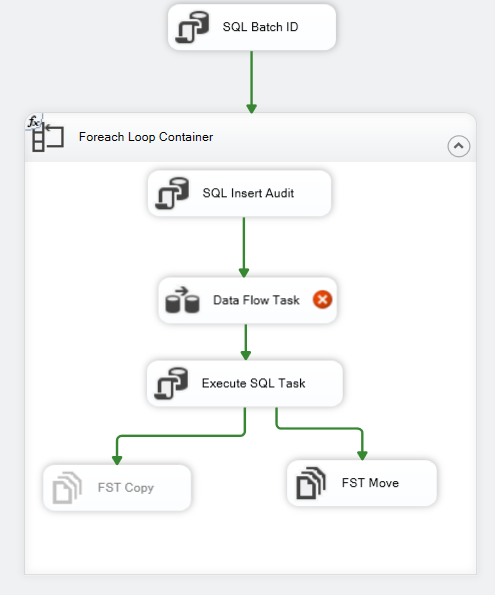
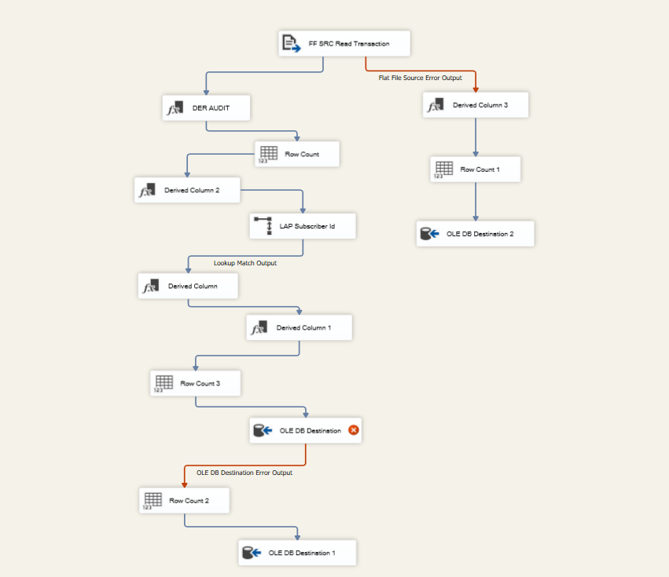

# Telecom Data Warehouse ETL Pipeline (SSIS)

## 📌 Project Overview
This project implements an end-to-end ETL (Extract, Transform, Load) pipeline using **SQL Server Integration Services (SSIS)** and **SQL Server**. The pipeline automates the ingestion, transformation, validation, and auditing of periodic customer transaction CSV files generated by a telecom network every 5 minutes.

---

<p align="center">
  
</p>

## 🏗️ Repository Architecture & Folder Structure

```plaintext
├── Processed Files/      # Archive directory for successfully ingested CSV files
├── Source Files/         # Landing directory for incoming periodic transaction batch files
├── SQL Qureries/         # DDL/DML scripts (Staging, Target, Lookup, and Error tables)
├── SSIS_Telecom/         # SSIS Visual Studio Project solution (.sln, .dtsx packages)
└── README.md             # Project documentation
```

---

## ⚙️ Business Requirements & ETL Logic

### 1. Source System
- **File Type:** Comma-Separated Values (CSV).
- **Frequency:** Incoming file generated every 5 minutes.
- **Source Schema:**
  - `ID` (Int, Non-nullable)
  - `IMSI` (String(9), Non-nullable)
  - `IMEI` (String(14), Nullable)
  - `CELL` (Int, Non-nullable)
  - `LAC` (Int, Non-nullable)
  - `EVENT_TYPE` (String(1), Nullable)
  - `EVENT_TS` (Timestamp, Non-nullable)

---

### Control Flow

<p align="center">
  
</p>


### Data Flow

<p align="center">
  
</p>

### 2. Transformation & Mapping Rules

| Source Column | Target Column | Transformation / Business Rule |
| :--- | :--- | :--- |
| **ID** | `Transaction_id` | Mapped as-is |
| **IMSI** | `IMSI` | Mandatory field: Reject record if `NULL` |
| **IMSI** | `subscriber_id` | Lookup with IMSI Reference Table; default to `-99999` if not found |
| **IMEI** | `TAC` | Substring first 8 characters; set to `-99999` if `NULL` or length < 14 |
| **IMEI** | `SNR` | Substring last 6 characters; set to `-99999` if `NULL` or length < 14 |
| **IMEI** | `IMEI` | Mapped as-is |
| **CELL** | `CELL` | Mandatory field: Reject record if `NULL` |
| **LAC** | `LAC` | Mandatory field: Reject record if `NULL` |
| **EVENT_TYPE** | `EVENT_TYPE` | Mapped as-is |
| **EVENT_TS** | `EVENT_TS` | Validate `DATETIME` format; reject record if invalid format or `NULL` |

---

### 3. Data Quality & Error Handling
- Invalid records (missing mandatory fields or corrupted datetime stamps) are diverted away from the destination table.
- All rejected records are inserted into a dedicated **Audit / Rejection Table** alongside the source CSV file name for tracking.

---

### 4. Post-Processing & Archiving
- Following the successful extraction and staging of valid records, the source file is automatically relocated from `Source Files/` to `Processed Files/` using an SSIS **File System Task** to prevent duplicate runs.

---

## 🛠️ Tech Stack
- **ETL Platform:** SQL Server Integration Services (SSIS)
- **RDBMS:** Microsoft SQL Server
- **Query Language:** T-SQL
- **Data Formats:** Flat Files (CSV), Relational Schemas

---

## 🚀 Setup & Execution Guide

1. **Deploy Database Tables:**
   - Execute the SQL scripts in the `SQL Qureries/` folder to create the staging, reference, destination, and error logging tables.
2. **Open SSIS Solution:**
   - Launch Visual Studio / SSDT and open the project inside `SSIS_Telecom/`.
3. **Configure Connection Managers:**
   - Update the ADO.NET / OLE DB connections to point to your local SQL Server instance.
   - Adjust the Flat File Connection Manager paths to match your local paths for `Source Files/` and `Processed Files/`.
4. **Run the Package:**
   - Place a batch CSV file in `Source Files/` and trigger the package execution.

